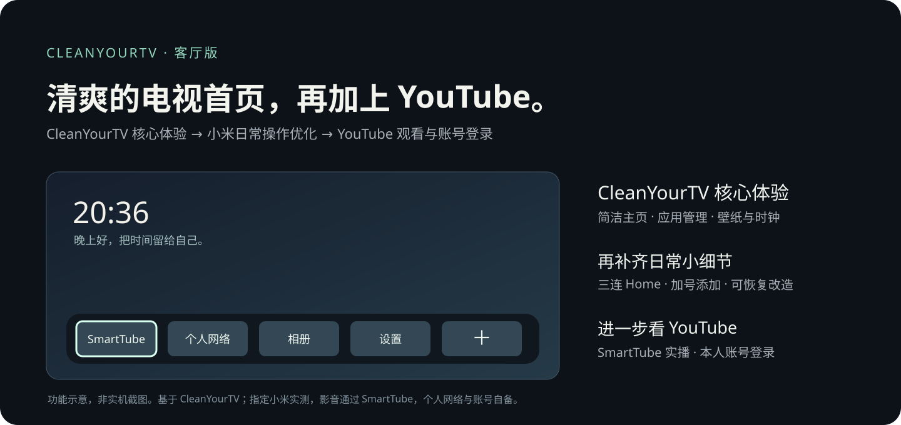

# CleanYourTV 客厅版

**CleanYourTV 的清爽桌面，加上小米电视看 YouTube 的完整体验。**

> 当前为私有预览阶段，源码已上传，首次 GitHub 自动检查已通过。公开发布另行决定；项目功能、来源和验证范围见下文及 [验证记录](VERIFICATION.md)。

以 CleanYourTV 为基础，保留简洁主页、应用库与排序、个人壁纸、闲置时钟等核心体验，让电视首页回到时间、图片和常用应用。我们在指定小米电视上补齐三连 Home 双向切换、加号添加应用、长按移除、方向键去重和可恢复的适配流程。

**在这个基础上，我们进一步打通了电视看 YouTube：** 通过 SmartTube 搜索和观看内容、登录自己的账号，加载订阅、播放列表与观看历史。个人 VPN 配置是这条流程的实现环节，使用者提供自己的可用网络配置。



基于 [CleanYourTV](https://github.com/Gathin23/cleanyourtv) 的独立实践分支，结合此前 [Aerial](https://github.com/pengchujin/aerial-tv) 定制中的 Home 守护与恢复经验。当前是 **3.0-living.1 实验版源码**：一台小米实测基线、完整改动说明、可选扩展，以及交给其他使用者 Agent 的逐机适配方法。

## 先保留 CleanYourTV 的核心体验

**简洁主页、应用库与排序、时钟、主题和壁纸轮换**来自 CleanYourTV。它们构成这个项目的基础：用自己的主页替代原首页的推荐布局，把常用应用和喜欢的画面放到前面。原厂屏保的处理仍按机型核对、先备份再执行，不代表消除全部系统或视频内广告。

### 我们补上的日常细节

| 你会感受到的变化 | 怎么做 |
|---|---|
| **两个首页，三下切换** | 指定小米基线上约 2 秒内连按 3 下 Home，双向切换，保存选择；保留原厂桌面和原省电方式 |
| **主页只放想要的应用** | 灰色「＋」打开应用库；长按 OK 从主屏移除。移除快捷方式不会卸载应用，选择会保留 |
| **壁纸是主角** | 底栏初始贴近屏幕下方，向下浏览时再展开应用；公开默认关闭应用色光晕，让换焦点不染色 |
| **客厅有自己的画面** | 个人静态图片可用于主页与闲置时钟，预设 5 分钟顺序轮换；闲置时钟的位置随时间移动 |
| **遥控器按一次，就是一次** | 在实测小米上修正方向键重复触发；三连 Home 不靠把普通方向键全挡掉来实现 |
| **改造有记录，也留退路** | 广告体检、真实观看结果、原状态快照和冲突检查；只恢复自己记录的改动 |
| **遇到问题，Agent 有路可走** | 型号识别、分层安装、故障表、验证模板和恢复步骤都在仓库里 |

[完整功能与改动来源](docs/FEATURES.md) · [安装指南](docs/INSTALL.md) · [给 Agent 的提示词](PROMPT.md) · [已知限制](docs/KNOWN-LIMITATIONS.md)

## 在这个基础上，打通小米电视看 YouTube

| 重点成果 | 已做到什么 |
|---|---|
| **YouTube 内容真正播起来** | 通过 SmartTube 搜索视频、打开博主频道并实际观看；1080p60 AVC 有画面和时间推进记录，1440p24 VP9 也有实播记录 |
| **登录自己的账号，接上自己的内容** | 按电视显示的连接码在手机浏览器完成 Google 授权；本机已登录成功，并加载订阅、播放列表／稍后观看和账号观看历史 |
| **个人 VPN 配到电视上** | 把已有 Clash/Mihomo 配置转换为电视可导入的私人副本，在电视端客户端连接；本机 VPN、规则模式与 HTTPS 连通已验证。电脑原配置保留 |
| **加载不只剩下转圈** | SmartTube 加载时显示实时网速与缓存秒数，每秒刷新，恢复播放后收起 |
| **从自己测过的线路里自动选** | 以实测候选生成120秒检测、150ms切换容差的自动选择组；另保留故障回退和手动入口，不附带个人节点 |

**实现方式：Clash Meta for Android + 个人网络配置 + SmartTube。** 我们的工作是把配置迁移、电视端使用、播放排查与登录验证连起来，并提供中文提示和可复用的适配方法；客户端与账号功能来自相应上游项目。SmartTube 是第三方客户端，Google 官方 YouTube App 在本机仍未通过设备兼容检查。

实测范围为 **MiTV-MFTR0 / Android 14 / OS3.0.101.0.UFTMATV**。每位使用者需要自己的可用网络配置和账号；项目不提供订阅或节点。4K60 与待机后网络自动恢复尚未通过完整验收，实际收藏写入也未替用户操作。按 [小米 VPN、YouTube 与登录说明](docs/OPTIONAL-MODULES.md) 复用这条路径。新增[实时网速与自动选线](docs/PLAYBACK-NETWORK.md)的实现、使用方法和短时1080p30实播证据；这次观测不替代同片同画质或长期测试。

## 从这里开始

1. 对照 [兼容范围](docs/LOCAL-FORK-COMPATIBILITY.md)。已实测：小米 S Pro 75 Mini LED / MiTV-MFTR0 / Android 14 / OS3.0.101.0.UFTMATV。其他电视从未验证开始，由自己的 Agent 逐项适配。
2. 按 [构建说明](docs/BUILD.md) 在电脑构建。Debug 可直接生成测试 APK；Release 没有私人签名时生成未签名 APK。**本仓库不放维护者密钥和个人定制 APK。**
3. 先当普通应用打开，确认界面和遥控器，再决定是否启用适配后的 Home 守护。当前小米专用助手保留精确型号/固件检查。
4. 选自己的壁纸，添加常用应用。网络、影音与设备检测需要时再按 [可选扩展](docs/OPTIONAL-MODULES.md) 配置。

```text
python -m unittest discover -s custom-tools -p test_*.py -v
cd launcher
# Windows 用 gradlew.bat，macOS/Linux 用 sh gradlew
./gradlew testReleaseUnitTest lintRelease assembleDebug assembleRelease
```

JDK 17 · Python 3.12 · Gradle 8.14.3 · Android SDK 36 / Build Tools 35.0.0 · Android 8+。

## 核心保持简单，扩展按需接入

- **核心桌面**：不申请 INTERNET 权限，运行不依赖电脑常在线；主页守护初始关闭，需要明确安装配置。
- **电视扩展**：独立的网络/设备状态页和影音入口；它会按用户操作发起连通性请求，与核心权限分离。
- **SmartTube 中文与网速补丁**：常见错误中文化、保留错误码；加载时显示实时网速和缓存，正常播放收起。独立包名可与原版并存。频道、订阅、播放列表和历史来自 SmartTube 上游能力，本机已登录验证。
- **个人网络迁移**：把自己的 Clash/Mihomo 配置转换为电视副本，移除电脑控制接口、保留指定局域网直连。不提供节点或账号，不自动改电脑原配置。
- **本地 4K 视频背景**：保留可选导入能力，主页和闲置时钟分别选择、静音循环、离开释放、失败回退。当前实机日常采用静态壁纸，动态能力默认关闭。

## 先把边界讲清楚

新主页避开了原主页推荐/促销布局；已核验的小米影视屏保可以经备份后停用。**不代表去掉所有系统广告，也不处理视频 App 的片头、中插和画面植入。** 原厂开机广告设置在本次改造前已关闭，不计为新成果。

保留省电待机时，本机唤醒仍会先短暂显示原首页；静态 UI 为 1080p；SmartTube 1080p60 实播通过、4K60 尚未通过。真正冷启动、长期稳定、完整实机恢复及 HDMI 实播仍未验收。Netflix 暂停，电视 Codex 已移除。详见 [限制与验证](docs/KNOWN-LIMITATIONS.md)。

本地与首次 GitHub 自动检查通过不等于所有机型兼容。当前版本没有同步安装到作者电视，实机证据来自其功能基线；源码打包改变了默认主题、构建与维护选项，需按指南验收。

## 参与适配

不要求维护者买齐所有电视。让你的 Agent 从 [逐机指南](docs/LOCAL-FORK-AGENT-GUIDE.md) 开始，用 [设备报告](docs/DEVICE-REPORT-TEMPLATE.md) 留下型号、固件、逐项结果与回退；核对并脱敏后再决定是否提交。上游的多机型经验不等于本分支已测。

[贡献说明](CONTRIBUTING.md) · [安全与隐私](SECURITY.md) · [更新记录](CHANGELOG.md) · [发布说明草稿](docs/RELEASE-NOTES.md)

## 致谢与许可

原生界面、时钟、应用库、排序、主题/壁纸轮换等基础来自 CleanYourTV；本分支的价值在实机适配、细节补充、修复和交付方法。Home 守护等沿用此前 Aerial 定制工作。保留 [CleanYourTV MIT](LICENSE)、[Aerial MIT](LICENSE-AERIAL)、[Outfit 字体 OFL](launcher/FONT-LICENSE-OFL.txt)；新增代码采用 MIT。详细来源见 [第三方说明](THIRD_PARTY_NOTICES.md)。

公开包不含个人电影壁纸、Google 图标改包、第三方 APK、网络订阅、账号和设备备份。品牌属于各自权利人，本项目与电视厂商、Google、影音或网络客户端没有官方隶属关系。
